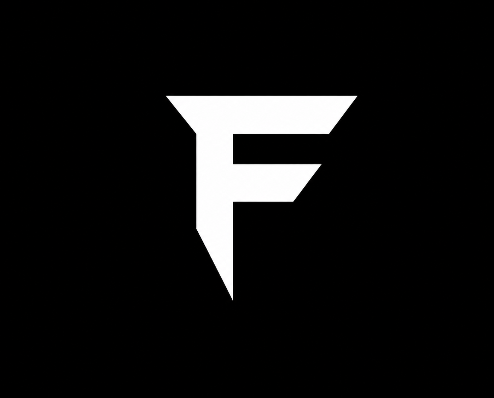
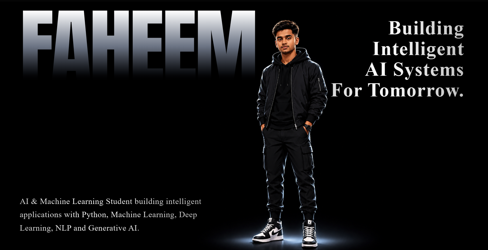

# 🚀 Mohammed Faheem - Portfolio

<p align="center">
  
</p>

<h3 align="center">
AI & Machine Learning Student | Python Developer | AI Enthusiast
</h3>

<p align="center">
A modern developer portfolio built with React, TypeScript, Tailwind CSS, and Framer Motion to showcase my projects, certifications, and technical journey.
</p>

<p align="center">
  <a href="YOUR_LIVE_URL"><strong>🌐 Live Demo</strong></a> •
  <a href="https://github.com/faheem231"><strong>GitHub</strong></a> •
  <a href="https://www.linkedin.com/in/mohammed-faheem-01473b370/"><strong>LinkedIn</strong></a>
</p>

---


## 📸 Preview



# ✨ Features

- 🎨 Modern dark UI
- ⚡ Smooth animations with Framer Motion
- 📱 Fully responsive design
- 👨‍💻 Professional hero section
- 📂 Interactive project showcase
- 🏆 Certifications section
- 🛠 AI Engineering Toolkit
- 📄 Downloadable Resume
- 📬 Contact section
- 🌙 Premium glassmorphism design

---

# 🛠 Tech Stack

### Frontend

- React
- TypeScript
- Vite
- Tailwind CSS
- Framer Motion

### Languages

- Python
- JavaScript
- TypeScript

### AI & ML

- NumPy
- Pandas
- Scikit-learn
- OpenCV

### Backend

- Flask
- SQLite
- PostgreSQL

### Tools

- Git
- GitHub
- VS Code
- Firebase
- Docker

---

# 📂 Folder Structure

```text
portfolio/
│
├── public/
│   ├── assets/
│   └── resume.pdf
│
├── src/
│   ├── assets/
│   ├── components/
│   ├── pages/
│   ├── App.tsx
│   └── main.tsx
│
├── package.json
└── README.md
```

---

# 🚀 Getting Started

### Clone the repository

```bash
git clone https://github.com/faheem231/portfolio.git
```

### Navigate to the project

```bash
cd portfolio
```

### Install dependencies

```bash
npm install
```

### Start development server

```bash
npm run dev
```

### Build for production

```bash
npm run build
```

---

# 📂 Featured Projects

## 🤖 ResumeAI

An AI-powered resume analyzer that evaluates ATS compatibility, extracts resume information, and provides personalized recommendations.

**Tech Stack**

- Python
- Flask
- React
- NLP
- SQLite

---

## 🌐 Personal Portfolio

A modern developer portfolio showcasing projects, certifications, technical skills, and achievements with smooth animations and premium UI.

**Tech Stack**

- React
- TypeScript
- Tailwind CSS
- Framer Motion

---

# 🏆 Certifications

- Infosys Springboard — Basics of Python
- GDG On Campus — Cepheus Hackathon Participation

---

# 🎯 Current Focus

- Artificial Intelligence
- Machine Learning
- Deep Learning
- Computer Vision
- Natural Language Processing

---

# 📬 Connect With Me

**LinkedIn**

https://www.linkedin.com/in/mohammed-faheem-01473b370/

**GitHub**

https://github.com/faheem231

---

# ⭐ Support

If you like this project, consider giving it a ⭐ on GitHub.

It motivates me to continue building and sharing more AI projects.

---

<p align="center">
Built with ❤️ by <strong>F Mohammed Faheem</strong>
</p>
